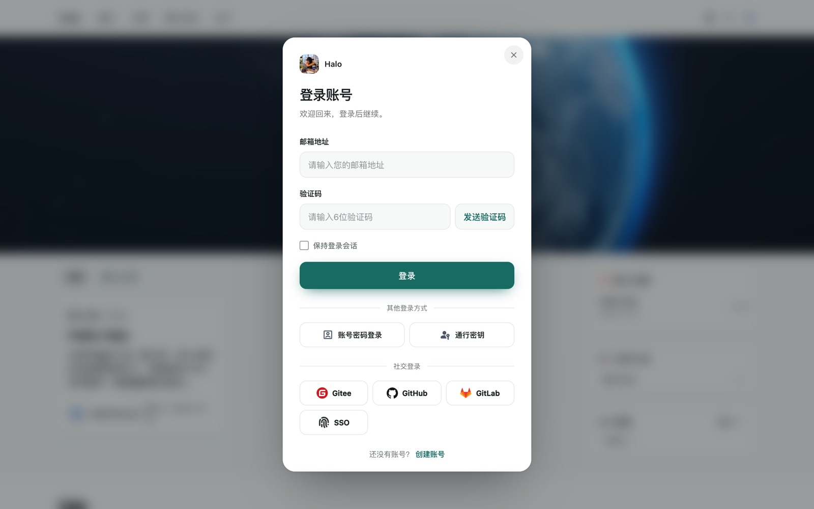
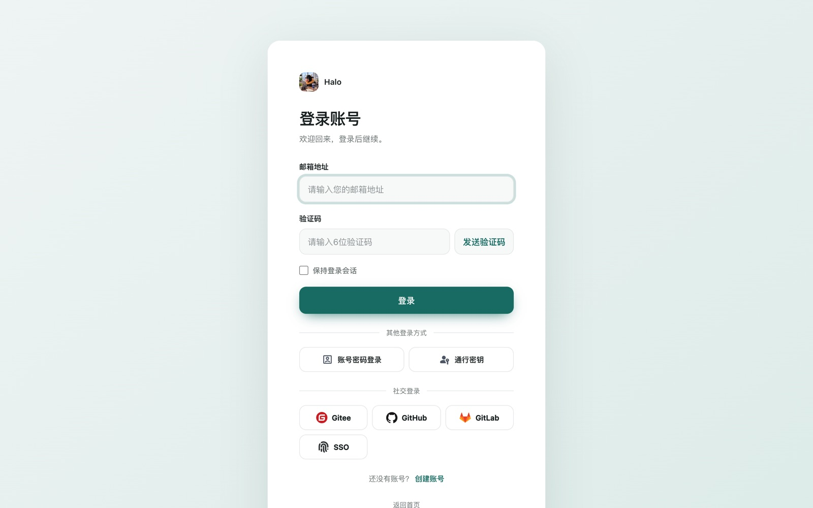
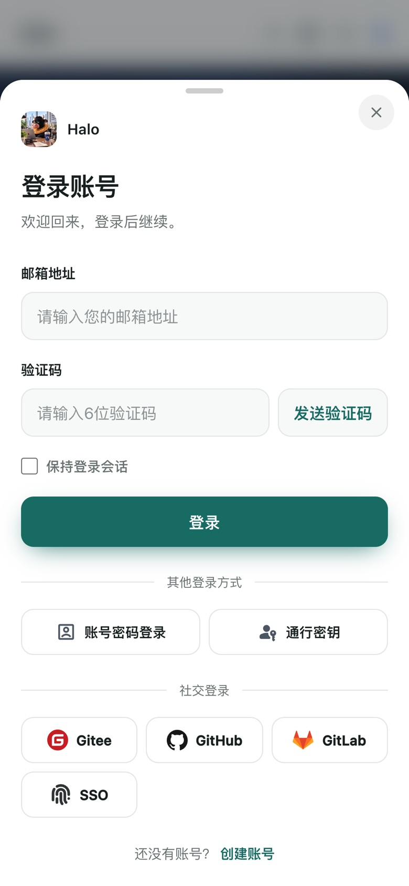
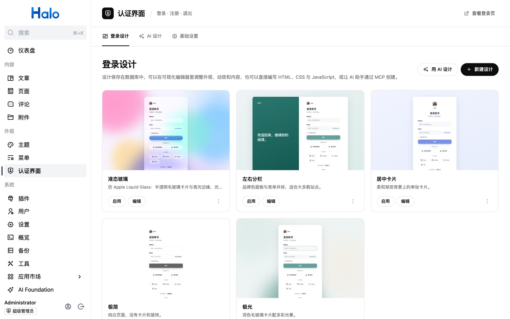
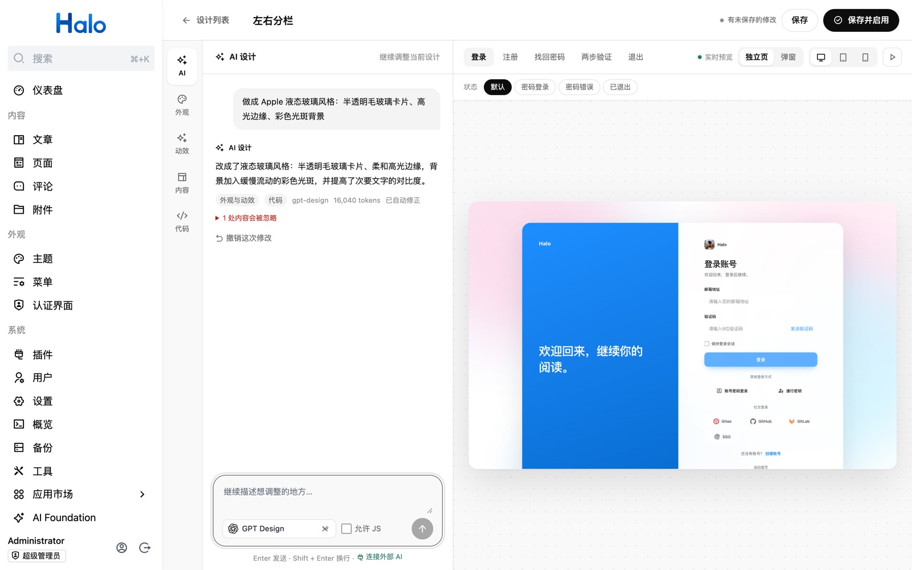
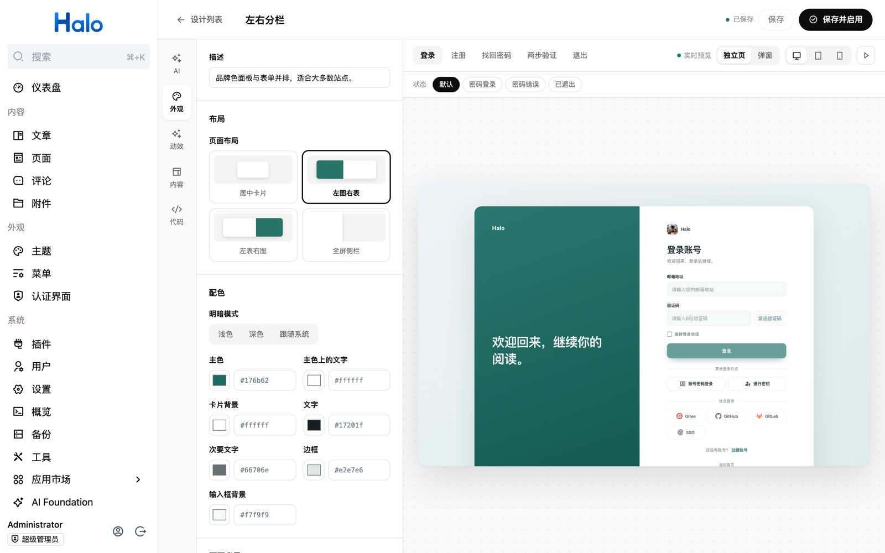
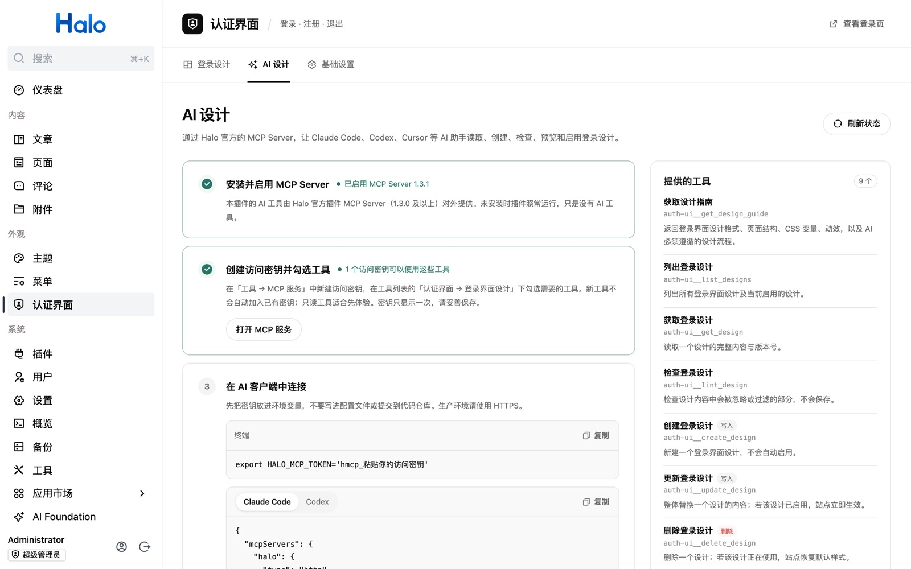

# 认证界面（auth-ui）

Halo 2.x 插件：为全站登录、注册、找回密码和退出提供统一的登录弹窗与独立页面，无需修改主题。表单仍由 Halo 原生认证流程处理，插件只负责外观。

- **弹窗优先**：站内登录入口、`/login`、`/signup`、`/logout`、密码重置链接以及后台登录都在当前页面弹窗中完成，手机上是底部抽屉。
- **登录设计**：设计保存在数据库中，可以在设计工作室里可视化调整外观、动效和内容，或直接编写 HTML、CSS 与 JavaScript，并实时预览独立页和弹窗。
- **AI 设计**：在工作室里直接和 AI 对话改设计（Halo AI Foundation），或让 Claude Code、Codex 等外部 AI 通过 Halo MCP Server 创建设计。

## 截图

> 截图来自本地开发站点，AI 对话中的结果由测试用模型生成。

**站内登录弹窗**：在任意页面打开，背景为当前页面。



<table>
  <tr>
    <td width="68%"></td>
    <td></td>
  </tr>
  <tr>
    <td align="center">独立登录页（<code>?auth_ui_page=1</code> 或关闭弹窗模式）</td>
    <td align="center">手机上的底部抽屉</td>
  </tr>
</table>

**登录设计**：后台「外观 → 认证界面」管理所有设计，可以启用、编辑、复制，或从内置案例新建。



**设计工作室 · AI 对话**：描述想要的效果，AI 修改当前设计，右侧实时预览；结果需要手动保存，也可以撤销。



**设计工作室 · 可视化编辑**：外观、动效、内容和代码分区调整，支持登录、注册、找回密码、两步验证、退出各页面与多种状态的预览。



**外部 AI（MCP）**：按步骤连接 Halo MCP Server，并查看本插件提供的工具。



## AI 设计（MCP + Skill）

安装并启用 [Halo MCP Server](https://github.com/halo-dev/plugin-mcp-server) 1.3.0 及以上版本后，本插件会在「工具 → MCP 服务」中贡献「登录界面设计」分类下的工具。没有 MCP Server 时插件照常运行。

| 工具 | 作用 |
| --- | --- |
| `auth-ui__get_design_guide` | 设计格式、页面结构、CSS 变量、动效与 `AuthUI` API 说明 |
| `auth-ui__list_designs` / `auth-ui__get_design` | 列出、读取设计（含版本号） |
| `auth-ui__lint_design` | 检查会被忽略或过滤的内容，不保存 |
| `auth-ui__create_design` / `auth-ui__update_design` | 新建、整体替换设计（带版本号防止覆盖） |
| `auth-ui__preview_design` | 各页面独立页与弹窗的预览链接 |
| `auth-ui__activate_design` | 应用到全站，空字符串恢复默认样式 |
| `auth-ui__delete_design` | 删除设计 |

控制台「认证界面 → AI 设计」页会显示 MCP Server 与访问密钥的状态，并给出客户端配置。新工具不会自动加入已有访问密钥，需要在 MCP 服务中为密钥勾选。

不需要安装 Skill：`auth-ui__get_design_guide` 返回设计指南，并附上 `.agents/skills/auth-ui-design` Skill 的工作流程（设计规范、先检查再保存、给出预览链接、确认后再启用）。其它工具的说明也提示 AI 先读指南。需要离线使用或自定义流程时，仍可在页面上下载 `SKILL.md`。

## 站内 AI 设计（AI Foundation）

安装并启用 [Halo AI Foundation](https://www.halo.run/store/apps/app-acslk9nu) 1.3.0 及以上版本后，设计工作室默认打开「AI」对话（设计列表的「用 AI 设计」也会直接进入）：

- 输入框里可以选择 AI Foundation 中的语言模型（浏览器会记住选择），不选则使用「AI Foundation → 默认模型」。
- 用一句话描述想要的效果，或点选灵感填入输入框；Enter 发送，Shift + Enter 换行，生成中可以停止。追问会带上之前的需求，例如「再亮一点」。
- AI 只返回需要改动的字段，插件合并后立即刷新预览。
- 系统提示词包含 `auth-ui-design` Skill 的「Designing」设计规范和完整设计指南，与外部 Agent 通过 MCP 设计时遵循同一套规则（Skill 改动后重新构建即同步）。保存、预览、启用由工作室按钮完成，不交给 AI。
- 结果会先经过检查，发现会被过滤的内容或文字对比度不足（低于 4.5:1）时，自动让模型修正一次，剩余问题以警告列出。
- 结果不会自动保存，可以一键撤销；JavaScript 默认不允许 AI 编写，需要手动勾选。

没有 AI Foundation 或没有默认模型时，面板会提示如何设置，插件其它功能不受影响。接口为 `GET /apis/api.authui.xhhao.com/v1alpha1/assistant?modelName=`（可用状态）与 `POST .../suggestions`（`{design, instruction, history, allowScript, modelName}`，生成修改）。

## 开发环境

- Java 21+
- Node.js >=22.12.0
- pnpm

## 开发

```bash
# 启用插件
./gradlew haloServer
# 开发前端
cd ui
pnpm install
pnpm dev
```

## 构建

```bash
./gradlew build
```

构建完成后，可以在 `build/libs` 目录找到插件 jar 文件。

## 许可证

[GPL-3.0](./LICENSE) © Handsome
